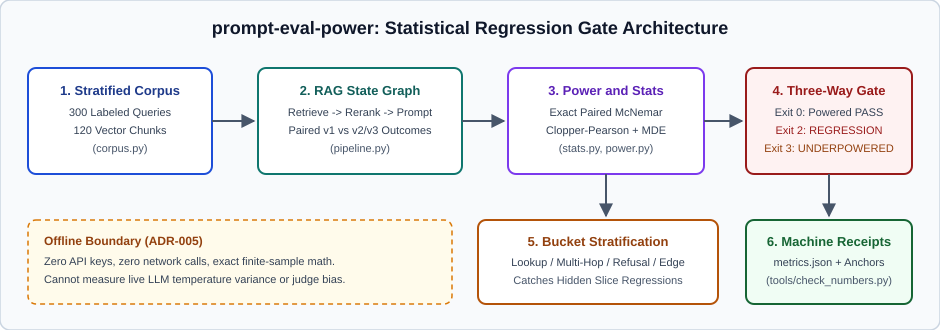
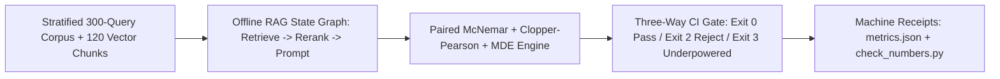
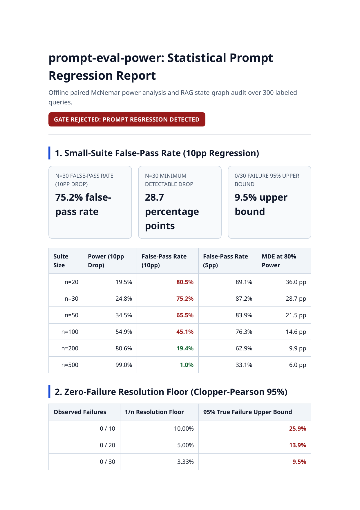
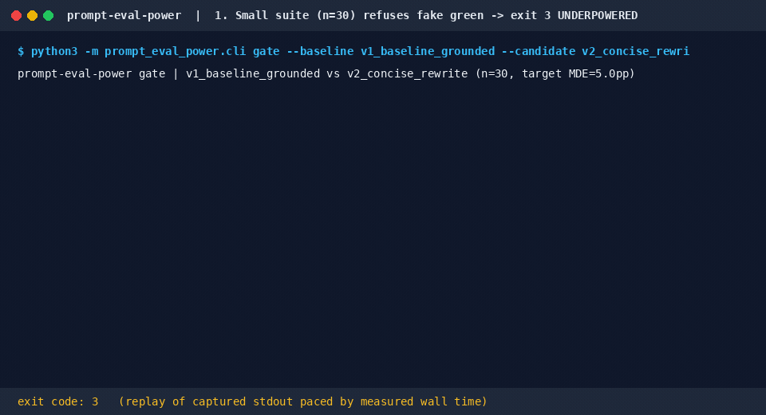

# prompt-eval-power

**Statistical regression gate and power analyzer for RAG and LangGraph prompt engineering that refuses to print fake green checkmarks on underpowered evaluation suites.**

## The structural impossibility

A pass-rate threshold on a small prompt evaluation set cannot separate a real prompt regression from binomial sampling noise, so a CI gate either ships broken prompts silently or blocks harmless edits. Four questions this repository answers that a standard prompt-eval script does not:

1. How often does a typical 30-query prompt evaluation suite silently pass a real 10-percentage-point prompt regression?
2. When a prompt passes 30/30 golden queries with zero failures, how high can its true production failure rate still be?
3. How many labeled queries does paired McNemar evaluation save over an unpaired pass-rate gate, and when does paired evaluation actually need *more* queries?
4. When a concise prompt rewrite barely changes simple lookup accuracy, how many discordant pass-to-fail flips hide inside refusal and multi-hop policy buckets?

## The uncomfortable numbers

* **A 30-query prompt suite misses most 10pp regressions:** At `n=30` (`p_base=85%`, `alpha=0.05`), an unpaired pass-rate gate has a **75.2% false-pass rate** on a 10pp drop and can only reliably detect regressions of **28.7 percentage points** or worse at 80% power.
* **Zero failures on 30 queries is not 0% failure:** Passing `0/30` leaves a **9.5% upper bound** (95% Clopper-Pearson) on the true failure rate; certifying `<1%` failure requires **299 zero-failure queries**.
* **Paired testing is not a universal win:** While paired McNemar cuts sample size from **714 unpaired queries** to **369 paired queries** at 15% discordance (for a 5pp drop at 80% power), a high-churn rewrite that scrambles outcomes requires **1111 queries at 45%** discordance (worse than unpaired).
* **Refusing a fake green checkmark:** On `v1_baseline_grounded` vs `v2_concise_rewrite` across **300 labeled queries**, the full suite catches **29 pass-to-fail flips** (`exit 2`), whereas running the exact same broken prompt on `n=30` exits `3` (`UNDERPOWERED`, **deficit of 216 queries**) instead of returning green.

Verified by **74 tests** at **99.1% line coverage**; every published figure is re-measured from code and verified against prose by `tools/check_numbers.py` in CI.

## Quickstart

Prerequisites: Python 3.10+, `numpy`, `scipy`.

```bash
git clone https://github.com/vaishnavi-lolla/prompt-eval-power.git
cd prompt-eval-power
python3 -m pip install -e .

# See n=30 refuse a fake green checkmark (exits 3: UNDERPOWERED)
PYTHONPATH=src python3 -m prompt_eval_power.cli gate --sample-size 30

# See n=300 catch the prompt regression (exits 2: REJECT_REGRESSION)
PYTHONPATH=src python3 -m prompt_eval_power.cli gate --sample-size 300

# Run lint, full test suite, all four experiments, and machine-checked receipts offline
make verify
```

## 1. Small-suite blindness: false-pass rates and MDE (Experiment 01)

| Suite Size | Power (10pp Drop) | False-Pass Rate (10pp) | False-Pass Rate (5pp) | MDE at 80% Power |
| ---: | ---: | ---: | ---: | ---: |
| `n=20` | 19.5% | 80.5% | 89.1% | 36.0 pp |
| `n=30` | 24.8% | 75.2% | 87.2% | 28.7 pp |
| `n=50` | 34.5% | 65.5% | 83.9% | 21.5 pp |
| `n=100` | 54.9% | 45.1% | 76.3% | 14.6 pp |
| `n=200` | 80.6% | 19.4% | 62.9% | 9.9 pp |
| `n=500` | 99.0% | 1.0% | 33.1% | 6.0 pp |

## 2. Paired McNemar vs unpaired sample size (Experiment 02)

Evaluating baseline and candidate prompts on identical queries cancels shared query difficulty variance when discordance is moderate, but loses its advantage when a rewrite causes high churn across queries (5pp drop, 80% power, `p_base=85%`):

| Discordant Rate (`p10 + p01`) | Paired McNemar `n` | Unpaired `n` | Query Savings |
| ---: | ---: | ---: | ---: |
| 8% | 196 | 714 | +72.5% |
| 12% | 295 | 714 | +58.7% |
| 15% | 369 | 714 | +48.3% |
| 20% | 493 | 714 | +31.0% |
| 30% | 740 | 714 | -3.6% |
| 45% | 1111 | 714 | -55.6% |

## 3. Zero-failure resolution floor (Experiment 03)

A measured zero is never zero. Exact one-sided 95% Clopper-Pearson bounds for zero observed failures:

| Observed Failures | `1/n` Resolution Floor | 95% True Failure Upper Bound |
| ---: | ---: | ---: |
| `0 / 10` | 10.00% | 25.9% |
| `0 / 20` | 5.00% | 13.9% |
| `0 / 30` | 3.33% | 9.5% |
| `0 / 50` | 2.00% | 5.8% |
| `0 / 100` | 1.00% | 3.0% |
| `0 / 300` | 0.33% | 1.0% |
| `0 / 500` | 0.20% | 0.6% |

## 4. Offline RAG / LangGraph prompt regression audit (Experiment 04)

Comparing `v1_baseline_grounded` against `v2_concise_rewrite` across 300 labeled queries shows how a concise rewrite leaves `direct_lookup` nearly untouched while silently breaking `negation_refusal` and `multi_hop_policy`:

| Query Bucket | Baseline Pass | Candidate Pass | Net Delta | Flips (`P->F` / `F->P`) | McNemar p-val | Bucket Breach |
| --- | ---: | ---: | ---: | ---: | ---: | --- |
| `direct_lookup` | 88.0% | 85.3% | -2.7 pp | 2 / 0 | 0.25000 | False |
| `ambiguous_edge` | 65.3% | 60.0% | -5.3 pp | 4 / 0 | 0.06250 | False |
| `multi_hop_policy` | 61.3% | 48.0% | -13.3 pp | 10 / 0 | 0.00098 | True |
| `negation_refusal` | 58.7% | 41.3% | -17.3 pp | 13 / 0 | 0.00012 | True |

| What `v2_concise_rewrite` saves | What it breaks |
| --- | --- |
| Cuts prompt token budget from 420 to 180 tokens and trims context from 3 to 2 chunks | Triggers 29 pass-to-fail flips (-9.7 pp overall, -17.3 pp on `negation_refusal`, -13.3 pp on `multi_hop_policy`) |

## Bug the measurement found

**Silent sample-size truncation hid underpowered runs:** Passing `--sample-size` greater than the corpus length (or `<= 0`) to `RagStateGraph.evaluate_prompt` previously sliced `self.corpus.queries[:limit]` without raising an error, silently evaluating fewer queries than requested. Fixed in commit `c4aebd4` by validating `1 <= limit <= len(self.corpus.queries)` at the boundary and pinned by `test_evaluate_prompt_rejects_limit_exceeding_corpus_size` and `test_evaluate_prompt_rejects_non_positive_limit`.

## Architecture





## Evidence

Section-verified screenshot of the HTML audit report generated by `tools/capture_screenshots.py` (which verifies CSS rule completeness and asserts WCAG AAA verdict badge contrast of 8.31:1):



Replay of captured CLI stdout paced by measured wall time (`tools/record_demo.py`; see [docs/video/manifest.json](docs/video/manifest.json) for commands, exit codes, and durations, and [docs/video/demo.mp4](docs/video/demo.mp4) for full quality):



## The corpus and hard cases

The deterministic generator (`src/prompt_eval_power/corpus.py`, seed `20260511`) builds 300 labeled queries and 120 unit-normalized embeddings (80 gold chunks + 40 hard distractors placed near each bucket's centroid) across four balanced slices: `direct_lookup`, `multi_hop_policy`, `negation_refusal`, and `ambiguous_edge`. Hard distractors guarantee non-zero baseline retrieval misses so no prompt scores an unrealistic 100%.

## What this cannot measure

Full boundary documented in [ADR-005](docs/adr/ADR-005-offline-judge-boundary-and-unmeasured-llm-variance.md):

* **Stochastic decoding variance (`temperature > 0`):** Offline grading is deterministic; live LLM calls with non-zero temperature add within-query variance that reduces effective power.
* **LLM-as-a-judge label noise:** Grader false positives and false negatives attenuate observed effect sizes and require judge-calibrated sample sizes.
* **Out-of-distribution production queries:** Static golden sets cannot measure regressions on unseen query classes until those queries are sampled and labeled.

## Layout, exit codes, and reproduction

```text
prompt-eval-power/
├── .github/workflows/ci.yml        # 3-Python matrix, ruff, pytest, coverage floor, receipts
├── docs/adr/                       # Five architecture decision records
├── docs/evidence/                  # Committed SVG diagram, report screenshots, manifests
├── docs/experiments/               # Re-measured JSON outputs from all four experiments
├── docs/video/                     # Captured stdout replay (demo.mp4, demo.gif, manifest.json)
├── experiments/                    # Four standalone experiment scripts
├── src/prompt_eval_power/          # config, stats, power, corpus, pipeline, report, cli
├── tests/                          # 74 property tests
└── tools/                          # collect_metrics.py, check_numbers.py, evidence generators
```

CLI exit codes:

* `0`: `PASS` (suite is sufficiently powered at target MDE and no significant regression occurred).
* `2`: `REJECT_REGRESSION` (statistically significant overall or per-bucket regression detected).
* `3`: `UNDERPOWERED` (no significant regression found, but suite lacks sample size to detect target MDE; exact deficit printed).
* `1`: Invalid input, out-of-bounds limit, or runtime error.

Make targets: `make lint`, `make test`, `make experiments`, `make receipts`, `make evidence`, and `make verify`.

## Tech stack and ADRs

| Technology | Role | Why chosen here |
| --- | --- | --- |
| Python 3.10 to 3.12 | Core runtime | Matches enterprise ML stacks and 3-version CI matrix |
| `scipy.stats` & `numpy` | Exact McNemar, Clopper-Pearson, cosine index | Exact finite-sample p-values, power curves, and deterministic vector retrieval |
| Offline RAG State Graph | Prompt template evaluator | Models LangGraph `retrieve -> rerank -> prompt -> grade` offline with zero API keys |
| `pytest`, `ruff`, `check_numbers.py` | Verification and receipts | Enforces 90%+ coverage floor, lint rules, and machine-checked prose numbers |

Architecture Decision Records:

1. [ADR-001: Deterministic Vector-Index and Prompt-Graph Fixture Over Live LLM Calls](docs/adr/ADR-001-deterministic-rag-fixture-over-live-llm-calls.md)
2. [ADR-002: Paired McNemar Testing Over Unpaired Pass-Rate Thresholds](docs/adr/ADR-002-paired-mcnemar-over-unpaired-pass-rate-thresholds.md)
3. [ADR-003: Distinct Exit Code 3 for Underpowered Suites Instead of Returning Green](docs/adr/ADR-003-resolution-floor-and-underpowered-gate-exit-code.md)
4. [ADR-004: Stratified Query Buckets Over Flat Golden Sets](docs/adr/ADR-004-stratified-query-buckets-over-flat-golden-sets.md)
5. [ADR-005: Offline Judge Boundary and What This Repository Cannot Measure](docs/adr/ADR-005-offline-judge-boundary-and-unmeasured-llm-variance.md)

## The Pivot and future work

* **Intentionally out of scope:** Live online A/B traffic routing or multi-armed bandit optimization for prompt variants. **Trigger condition:** Add it only after offline paired power gating runs in CI and production RAG logs capture verified outcome labels at sufficient daily volume.
* **v2 priorities:**
  * Judge-noise-adjusted power formulas incorporating measured LLM-judge precision and recall.
  * Repeated-trial (`k` runs per query) hierarchical McNemar testing for `temperature > 0` models.
  * Native LangGraph / Amazon Bedrock trace adapter emitting the same paired binary outcome JSON.
  * First metric to watch in production: weekly **negation/refusal bucket pass-to-fail flip rate** alongside total sample-size coverage.
